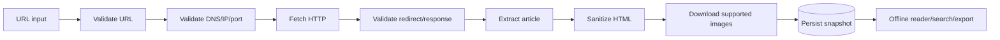

<div align="center">

# WebArchive Reader

### Lưu trang web · Đọc offline · Tìm đúng snapshot

Ứng dụng PHP + MySQL giúp lưu nội dung HTML công khai thành các snapshot bất biến,
đọc lại khi trang gốc thay đổi hoặc ngừng hoạt động, tìm kiếm trong nội dung đã lưu
và quản lý quyền truy cập theo thư viện.

<p>
  
  
  
  
</p>

</div>

## ✨ Điểm nổi bật

| 📚 Thư viện | 🌐 Fetch an toàn | 🧹 Reader sạch | 🔎 Tìm kiếm | 🕘 Lịch sử |
| --- | --- | --- | --- | --- |
| Owner/editor/viewer, thư viện riêng và chia sẻ | Kiểm tra URL, IP, port và redirect | Loại script, event handler, iframe và form | Tìm title + toàn bộ thân bài | Mỗi lần refresh tạo version mới |

- **Offline reader:** nội dung và ảnh đã cam kết lưu không phụ thuộc website nguồn khi mở lại.
- **Snapshot bất biến:** v1, v2, ... được giữ nguyên; ghi chú gắn với đúng phiên bản.
- **Phân quyền backend:** page, snapshot, asset, note và export đều kiểm tra membership.
- **Dữ liệu mẫu local:** 15+ fixture và 10 truy vấn kiểm thử, không phụ thuộc Internet.
- **Không framework lớn:** PHP thuần, PDO prepared statements, DOMDocument và cURL.

> **Phạm vi:** chỉ hỗ trợ HTML tĩnh công khai thuộc host đã được cho phép. Đây không phải
> công cụ tìm kiếm toàn Internet, không vượt đăng nhập/paywall và không tải JavaScript,
> CSS, video hoặc tài nguyên ngoài danh sách hỗ trợ.

## 🧭 Luồng hoạt động



## 🛠 Công nghệ và yêu cầu

- PHP **8.1+** với các extension:
  - `pdo_mysql`
  - `curl`
  - `dom`
  - `mbstring`
- MySQL 8+ hoặc MariaDB 10.4+.
- Apache + PHP; XAMPP được khuyến nghị trên Windows.
- Git.

## 🚀 Cài đặt nhanh với XAMPP

### 1. Khởi động XAMPP

Mở XAMPP Control Panel và bật:

```text
Apache
MySQL
```

### 2. Đặt source vào htdocs

```text
C:\xampp\htdocs\WebArchive
```

### 3. Tạo database

Mở [phpMyAdmin](http://localhost/phpmyadmin), tạo database:

```text
webshelf
```

Chọn collation:

```text
utf8mb4_unicode_ci
```

### 4. Import schema và dữ liệu mẫu

Trong phpMyAdmin, chọn database `webshelf` → **Import** lần lượt:

```text
database/schema.sql
database/seed.sql
```

Hoặc dùng terminal XAMPP:

```powershell
C:\xampp\mysql\bin\mysql.exe -u root -p webshelf < database\schema.sql
C:\xampp\mysql\bin\mysql.exe -u root -p webshelf < database\seed.sql
```

### 5. Cấu hình kết nối

Sao chép [config.example.php](config.example.php) thành `config.php`, sau đó điền
mật khẩu MariaDB local. Không commit `config.php`.

```php
'db' => [
    'dsn' => 'mysql:host=127.0.0.1;port=3306;dbname=webshelf;charset=utf8mb4',
    'user' => 'root',
    'pass' => 'MAT_KHAU_MYSQL',
],
```

Trong XAMPP mặc định, mật khẩu root thường để trống. Hãy dùng đúng cấu hình máy bạn.

### 6. Mở ứng dụng

- Ứng dụng: [http://localhost/WebArchive/public/](http://localhost/WebArchive/public/)
- Website fixture: [http://localhost/WebArchive/samples/site/article-01.html](http://localhost/WebArchive/samples/site/article-01.html)

Nếu trình duyệt giữ CSS cũ, nhấn `Ctrl + Shift + R`.

## 👤 Tài khoản demo

Seed data cung cấp ba tài khoản không có mật khẩu để mô phỏng quyền:

| Tài khoản | Vai trò | Quyền kiểm thử |
| --- | --- | --- |
| **Alice Editor** | `owner` | Tạo/xóa thư viện, lưu URL, refresh, note, export |
| **Bob Viewer** | `viewer` | Đọc và tìm kiếm trong thư viện được chia sẻ |
| **Eve Outsider** | Không có membership | Bị từ chối khi truy cập dữ liệu của người khác |

> Đây là tài khoản demo. Không dùng seed data hoặc tài khoản không mật khẩu khi triển khai
> công khai.

## 🎬 Hai kịch bản demo

### ① Lưu → đọc → tìm kiếm

1. Đăng nhập **Alice Editor**.
2. Chọn **Lưu trang**.
3. Nhập:
   ```text
   http://localhost/WebArchive/samples/site/article-01.html
   ```
4. Thêm nhãn `PHP` và bấm **Lấy và lưu**.
5. Mở snapshot `v1`.
6. Vào **Tìm kiếm**, nhập `mảng kết hợp`.

Từ khóa chỉ nằm trong thân bài vẫn phải trả về đúng bài và đúng snapshot.

### ② Refresh version và đọc offline

1. Lưu `article-07.html` để có ảnh local.
2. Mở snapshot và thêm ghi chú.
3. Đổi tên tạm `samples\site` thành `samples\site-disabled`.
4. Tải lại snapshot.
5. Khôi phục tên thư mục, mở bài và bấm **Lấy bản mới**.

Kỳ vọng: snapshot cũ và ghi chú cũ vẫn còn; ảnh đã lưu không cần tải lại từ nguồn.

## 🧪 Fixture và kiểm thử

Các fixture nằm trong [samples/site](samples/site), gồm:

| Nhóm | Fixture |
| --- | --- |
| Hợp lệ | `article-01.html` đến `article-11.html` |
| Ảnh | `article-01.html`, `article-07.html`, `image.php` |
| Lỗi | `not-found.php`, `empty.html` |
| Sanitization | `script.html` |
| Redirect | `redirect-outside.php` |

Danh sách 10 truy vấn và kết quả mong đợi: [samples/QUERIES.md](samples/QUERIES.md).
Test case bắt buộc: [docs/TEST-CASES.md](docs/TEST-CASES.md).

Kiểm tra cú pháp toàn bộ PHP bằng PowerShell:

```powershell
$files = Get-ChildItem -Recurse -File -Filter *.php
foreach ($file in $files) {
    php -l $file.FullName
}
```

Kiểm tra extension:

```powershell
C:\xampp\php\php.exe -m | Select-String "pdo_mysql|curl|dom|mbstring"
```

## 🧱 Cấu trúc dự án

```text
WebArchive/
├── database/
│   ├── schema.sql             # Schema chuẩn hóa và FULLTEXT index
│   └── seed.sql               # Tài khoản, thư viện, quyền và tag mẫu
├── docs/
│   ├── ARCHITECTURE.md
│   ├── DATA-MODEL.md
│   └── TEST-CASES.md
├── public/
│   ├── assets/styles.css      # Giao diện responsive
│   ├── index.php              # Front controller/router
│   └── uploads/               # Ảnh local, không commit dữ liệu thật
├── samples/site/              # Website fixture local
├── src/
│   ├── Fetcher.php            # Fetch, parse, sanitize, asset policy
│   ├── bootstrap.php          # Session, extension, PDO bootstrap
│   ├── functions.php          # Auth, CSRF, authorization, layout
│   └── routes_extra.php       # Note, compare, Markdown export
├── config.example.php
├── CONTRIBUTING.md
├── SECURITY.md
└── README.md
```

Tài liệu kiến trúc: [docs/ARCHITECTURE.md](docs/ARCHITECTURE.md).
Mô hình dữ liệu: [docs/DATA-MODEL.md](docs/DATA-MODEL.md).

## 🔐 Bảo mật và giới hạn

- Chỉ cho phép scheme HTTP/HTTPS, host và port trong allowlist.
- Kiểm tra DNS/IP, chặn địa chỉ nội bộ khi `allow_private_hosts=false`.
- Kiểm tra lại mọi redirect và không để cURL tự follow redirect.
- Giới hạn timeout, số redirect và kích thước response.
- Dùng prepared statements và CSRF token cho form POST.
- Sanitize HTML trước khi persist; reader không tin tưởng HTML gốc.
- Kiểm tra quyền ở backend trước khi đọc page, snapshot, asset, note hoặc export.
- Không commit `config.php`, password, token hoặc file upload.

Chi tiết báo cáo lỗ hổng: [SECURITY.md](SECURITY.md).

## 📚 Tài liệu

- [Kiến trúc](docs/ARCHITECTURE.md)
- [Mô hình dữ liệu](docs/DATA-MODEL.md)
- [Test cases](docs/TEST-CASES.md)
- [Truy vấn mẫu](samples/QUERIES.md)
- [Hướng dẫn đóng góp](CONTRIBUTING.md)
- [Changelog](CHANGELOG.md)
- [License](LICENSE)

## 🛠 Troubleshooting

| Lỗi | Cách xử lý |
| --- | --- |
| `could not find driver` | Bật `pdo_mysql` trong `C:\xampp\php\php.ini`, restart Apache |
| `Thiếu PHP extension` | Kiểm tra `curl`, `dom`, `mbstring`, `pdo_mysql` bằng `php -m` |
| `Unknown database 'webshelf'` | Tạo database `webshelf` và import `database/schema.sql` |
| `Table doesn't exist` | Import lại `database/schema.sql`, sau đó `database/seed.sql` |
| Form không có thư viện | Đăng nhập Alice và kiểm tra `library_members` |
| URL bị từ chối | Kiểm tra host/port trong `config.php`; XAMPP dùng port 80 |
| Font/CSS cũ | Nhấn `Ctrl + Shift + R` hoặc mở URL có `?v=...` |

## 📄 Giấy phép

Mã nguồn được phát hành theo [MIT License](LICENSE). Dữ liệu fixture trong `samples/`
là dữ liệu giả phục vụ học tập và kiểm thử.
